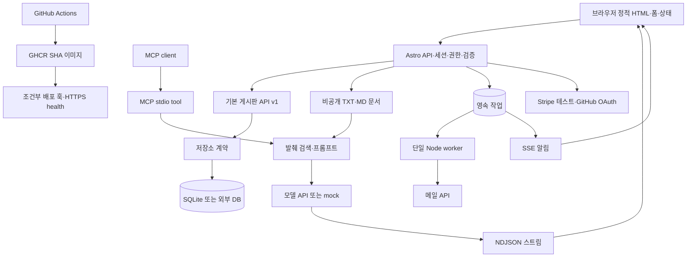

# studyFinal · Astro 문서 학습 데스크

## ① 목표 한 줄

midpoint 게시판에 DB 교체·외부 서비스·문서 AI·실시간·Docker·자동 배포를 연결해 Astro 하나의 학습 서비스를 완성한다.

### 기능 목록

| 기능 | 구현 위치 | 검증 구분 |
|---|---|---|
| 가입·쿠키/Bearer 세션·글/댓글 CRUD | basic-api/auth/posts | 로컬 HTTP·브라우저 확인 |
| SQLite·PostgreSQL·MariaDB·MongoDB 저장 계약 | store·DB compose·ORM 예제 | SQLite 확인, 외부 3종 실행 미검증 |
| UI·상태·폼 검증 | Pico CSS·Nano Stores·zod | 브라우저 확인 |
| 메일·결제·파일·OAuth | integrations/files | mock·파일 확인, 실제 계정 미검증 |
| 공개 목록 캐시·메일 작업 | cache/jobs/worker | 단위·로컬 작업 확인 |
| 실시간 알림·소켓 예제 | events·socket | 별도 검증 기록 참고 |
| 개인 문서 요약·근거 질문·이력 | documents·ai·questions | mock 스트리밍 확인, 실제 모델 품질 미검증 |
| MCP stdio 도구 검색·호출 | mcp-server/client | 실제 SDK 프로세스 호출 확인 |
| 이미지·CI·자동 배포 훅·백업 | Docker/Actions/backup | 파일 구성, Docker·외부 배포는 환경 필요 |

기준: [Notion Astro](https://app.notion.com/p/3fdd7dec5e2e8136a3d7e7023440d36f)와 [공통 API v1](https://app.notion.com/p/3d6d7dec5e2e8139adbfd36dd506c65e). AI 학습 연결은 [DocuForge](https://app.notion.com/p/40bd7dec5e2e818d9c91c6fb26dccc4c)의 문서 근거 응답과 [SocialForge](https://app.notion.com/p/40bd7dec5e2e81cb8c76d6d66962619a)의 생성·기록 흐름이다. 기존 프로젝트 서버를 연결하지 않고 Astro 내부 기능으로 구현한다.

## ② 📖 이론

완성 서비스는 기능을 많이 붙이는 것에 더해 실패 경계와 검증 범위를 설명할 수 있어야 한다. 화면은 정적 HTML, 개인 데이터는 인증 API, 원본은 DB, 파일은 비공개 저장소, 오래 걸리는 메일은 worker, 모델 출력은 취소 가능한 스트림이다. 각 경계는 연결 부위가 다른 배관처럼 입력·출력·실패 규칙이 정해져야 한다.

운영 배포의 완료와 학습 코드의 완성을 구분한다. 키 없는 mock이 실제 AI 품질·메일 전달·결제를 보장하지 않는다. 기본 설정은 외부 유료 호출을 만들지 않고 학습 흐름을 재현한다. 실제 운영 전에는 외부 DB 연결·제공자 테스트 계정·HTTPS·백업 복구·부하 검증이 추가로 필요하다.

## ③ 🛠️ 실기

### 연동 구성도



### 구현 순서

1. midpoint의 모든 인증·글·댓글 계약과 테스트를 먼저 통과시킨다.
2. study11의 DB_DRIVER/DATABASE_URL을 고르고 test:db를 수행한다. 기존 DB는 백업 후 별도 이관하며 연결만 바꿔 데이터가 이동한다고 가정하지 않는다.
3. study12의 Pico UI·Nano Stores·폼 zod를 연결한다.
4. study13의 TXT·MD 저장/소유권, mock 메일/테스트 checkout, 실제 키를 넣을 수 있는 OAuth·서명 웹훅 경계를 연결한다.
5. study14의 OpenAPI·requestId·오류·페이지 계약을 대조한다.
6. study15의 캐시 무효화·단일 worker·실패 재시도를 연결한다.
7. study16의 이미지·영속 볼륨·백업·CI·배포 훅을 구성한다.
8. study17의 SSE 알림과 소켓 예제를 확인한다.
9. study18의 문서 검색·AI 스트리밍·질문 이력·MCP 도구 호출을 확인한다.
10. 전체 테스트·보안 점검을 수행하고 실제 배포 환경의 미검증 항목을 별도로 닫는다.

```powershell
cd course
Remove-Item Env:COURSE_STAGE -ErrorAction SilentlyContinue
npm ci
npm test
npm run build
npm run test:http
npx playwright install chromium
npx playwright test
npm run mcp:client
npm start
```

1행은 앱으로 이동하고 2행은 midpoint 모드를 해제한다. 3행은 잠금 설치, 4행은 단위·저장소·mock 검사, 5행은 빌드, 6행은 실제 HTTP 계약, 7~8행은 브라우저 흐름, 9행은 MCP SDK 호출, 10행은 서비스 실행이다. `.env`도 COURSE_STAGE=midpoint로 고정돼 있지 않은지 확인한다. 별도 터미널의 npm run worker로 메일 작업을 처리한다.

### 최종 연결 코드 전체와 줄별 설명

기초 구현의 전체 파일은 studyMidpoint, DB와 ORM 전체는 study11, 결제·OAuth·파일 전체는 study13, 모델·화면·MCP 전체는 study18에 있다. 아래 파일은 최종 조립 경계를 생략 없이 보여 준다.

### `course/src/lib/api.mjs` 전체 코드

[api.mjs](course/src/lib/api.mjs)를 그대로 사용한다. 코드 블록의 줄 번호는 바로 아래 설명표와 일치한다.

```javascript
import { dispatchBasic, sessionCookie } from './basic-api.mjs';
import { z } from 'zod';
import { body, fail, json, positiveId } from './http.mjs';
import { validate } from './validation.mjs';
import { requireUser, owned } from './auth.mjs';
import { checkout, stripeWebhook, oauthStart, oauthCallback } from './integrations.mjs';
import { saveDocument, downloadDocument } from './files.mjs';
import { enqueueMail } from './jobs.mjs';
import { generate, retrieve } from './ai.mjs';
import { settings } from './config.mjs';

export async function dispatch(context, store) {
  const { request, url, locals } = context, method = request.method;
  const path = url.pathname.replace(/\/$/, ''), user = locals.user;
  const basic = await dispatchBasic(context, store);
  if (basic) return basic;
  if (process.env.COURSE_STAGE === 'midpoint') fail(404, 'NOT_FOUND', 'Midpoint mode exposes only auth and board APIs.');
  let match;
  if (path === '/api/mail' && method === 'POST') {
    requireUser(user); const job = await enqueueMail(store, user); return json({ data: job }, 202);
  }
  if (path === '/api/checkout' && method === 'POST') {
    requireUser(user);
    const { key } = validate(z.object({ key: z.uuid() }), await body(request));
    return json({ data: await checkout(user, settings().site, process.env, `checkout-${user.id}-${key}`) });
  }
  if (path === '/api/stripe/webhook' && method === 'POST') {
    // 외부에서 서명한 원문. 일반 JSON 파싱 전에 그대로 검증한다.
    const length = Number(request.headers.get('content-length'));
    if (!Number.isSafeInteger(length) || length < 1 || length > 65536) fail(413, 'PAYLOAD_TOO_LARGE', '웹훅 크기를 확인하세요.');
    const raw = await request.text();
    if (Buffer.byteLength(raw) > 65536) fail(413, 'PAYLOAD_TOO_LARGE', '웹훅이 너무 큽니다.');
    return json(await stripeWebhook(store, raw, request.headers.get('stripe-signature')));
  }
  if (path === '/api/oauth/start' && method === 'GET') return oauthStart(context.cookies, settings().site);
  if (path === '/api/oauth/callback' && method === 'GET') {
    const session = await oauthCallback(store, context, settings().site); sessionCookie(context, session.accessToken);
    return Response.redirect(`${settings().site}/board`, 302);
  }
  if (path === '/api/documents') {
    requireUser(user);
    if (method === 'GET') return json({ data: (await store.list('documents')).filter(d => d.authorId === user.id).map(({ key, text, ...d }) => d) });
    if (method === 'POST') { const d = await saveDocument(store, user, await body(request, 150000)); return json({ data: { id: d.id, name: d.name } }, 201); }
  }
  match = path.match(/^\/api\/documents\/([^/]+)\/download$/);
  if (match && method === 'GET') return downloadDocument(owned(await store.get('documents', positiveId(match[1])), user));
  if (path === '/api/ai' && method === 'POST') {
    requireUser(user);
    const input = validate(z.object({ documentId: z.number().int().positive(), question: z.string().trim().max(500).default('') }).strict(), await body(request));
    const doc = owned(await store.get('documents', input.documentId), user);
    const iterator = generate(doc.text, input.question, { signal: request.signal });
    // 첫 토큰까지 읽어 upstream HTTP 오류를 공통 JSON 오류로 반환한다.
    const first = await iterator.next(); let initial = true, answer = '', finished = false;
    const encoder = new TextEncoder();
    const stream = new ReadableStream({
      async pull(controller) {
        try {
          const item = initial ? first : await iterator.next(); initial = false;
          if (item.done) {
            if (!finished) await store.create('questions', { documentId: doc.id, authorId: user.id, question: input.question, answer,
              sources: input.question ? retrieve(doc.text, input.question) : [{ index: 1 }], createdAt: new Date().toISOString() });
            finished = true; controller.close();
          } else { answer += item.value; controller.enqueue(encoder.encode(JSON.stringify({ delta: item.value }) + '\n')); }
        } catch { controller.enqueue(encoder.encode(JSON.stringify({ error: '생성이 중단되었습니다.' }) + '\n')); controller.close(); await iterator.return(); }
      },
      async cancel() { await iterator.return(); },
    });
    return new Response(stream, { headers: { 'Content-Type': 'application/x-ndjson; charset=utf-8', 'Cache-Control': 'no-store' } });
  }
  if (path === '/api/events' && method === 'GET') {
    requireUser(user);
    const encoder = new TextEncoder(); let timer, stop, count = 0, busy = false;
    const stream = new ReadableStream({
      start(controller) {
        stop = () => { clearInterval(timer); request.signal.removeEventListener('abort', stop); try { controller.close(); } catch {} };
        request.signal.addEventListener('abort', stop, { once: true });
        controller.enqueue(encoder.encode('retry: 3000\n\n'));
        timer = setInterval(async () => {
          if (busy) return; busy = true;
          try {
            const jobs = (await store.list('jobs')).filter(j => j.userId === user.id);
            controller.enqueue(encoder.encode(`event: jobs\ndata: ${JSON.stringify(jobs.map(j => ({ id: j.id, status: j.status })))}\n\n`));
            if (++count >= 30) stop();
          } catch { stop(); } finally { busy = false; }
        }, 1000);
      }, cancel() { stop(); },
    });
    return new Response(stream, { headers: { 'Content-Type': 'text/event-stream', 'Cache-Control': 'no-cache', 'X-Accel-Buffering': 'no' } });
  }
  fail(404, 'NOT_FOUND', 'API 경로가 없습니다.');
}
```

줄별 설명:

| 줄 | 설명 |
|---|---|
| 1 | `'./basic-api.mjs'`의 기능을 이 파일에서 사용한다. |
| 2 | `'zod'`의 기능을 이 파일에서 사용한다. |
| 3 | `'./http.mjs'`의 기능을 이 파일에서 사용한다. |
| 4 | `'./validation.mjs'`의 기능을 이 파일에서 사용한다. |
| 5 | `'./auth.mjs'`의 기능을 이 파일에서 사용한다. |
| 6 | `'./integrations.mjs'`의 기능을 이 파일에서 사용한다. |
| 7 | `'./files.mjs'`의 기능을 이 파일에서 사용한다. |
| 8 | `'./jobs.mjs'`의 기능을 이 파일에서 사용한다. |
| 9 | `'./ai.mjs'`의 기능을 이 파일에서 사용한다. |
| 10 | `'./config.mjs'`의 기능을 이 파일에서 사용한다. |
| 11 | 코드 구간을 나누는 빈 줄이다. |
| 12 | 비동기 함수 `dispatch`의 입력과 처리 범위를 정의한다. |
| 13 | 이 이름의 값·객체·함수를 선언해 아래 처리에서 사용한다: `const { request, url, locals }`. |
| 14 | 이 이름의 값·객체·함수를 선언해 아래 처리에서 사용한다: `const path`. |
| 15 | 이 이름의 값·객체·함수를 선언해 아래 처리에서 사용한다: `const basic`. |
| 16 | 조건에 따라 성공·오류 또는 실행 환경별 경로를 선택한다. |
| 17 | 실행/빌드 환경에서 설정을 읽어 기본값 또는 분기를 결정한다. |
| 18 | 이 이름의 값·객체·함수를 선언해 아래 처리에서 사용한다: `let match;`. |
| 19 | 조건에 따라 성공·오류 또는 실행 환경별 경로를 선택한다. |
| 20 | 미인증 사용자를 401로 거절하고 인증 사용자만 다음 처리를 허용한다. |
| 21 | 앞서 연 함수·객체·호출의 범위를 닫는다. |
| 22 | 조건에 따라 성공·오류 또는 실행 환경별 경로를 선택한다. |
| 23 | 미인증 사용자를 401로 거절하고 인증 사용자만 다음 처리를 허용한다. |
| 24 | 정해진 스키마로 입력을 검사하고 허용된 값만 다음 계층으로 보낸다. |
| 25 | 실행/빌드 환경에서 설정을 읽어 기본값 또는 분기를 결정한다. |
| 26 | 앞서 연 함수·객체·호출의 범위를 닫는다. |
| 27 | 조건에 따라 성공·오류 또는 실행 환경별 경로를 선택한다. |
| 28 | 외부에서 서명한 원문. 일반 JSON 파싱 전에 그대로 검증한다. |
| 29 | 이 이름의 값·객체·함수를 선언해 아래 처리에서 사용한다: `const length`. |
| 30 | 조건에 맞지 않는 요청은 명시한 상태 코드와 공통 오류로 중단한다. |
| 31 | 이 이름의 값·객체·함수를 선언해 아래 처리에서 사용한다: `const raw`. |
| 32 | 조건에 맞지 않는 요청은 명시한 상태 코드와 공통 오류로 중단한다. |
| 33 | 명시한 상태와 JSON 응답 본문을 HTTP 계약에 맞춰 반환한다. |
| 34 | 앞서 연 함수·객체·호출의 범위를 닫는다. |
| 35 | 조건에 따라 성공·오류 또는 실행 환경별 경로를 선택한다. |
| 36 | 조건에 따라 성공·오류 또는 실행 환경별 경로를 선택한다. |
| 37 | 이 이름의 값·객체·함수를 선언해 아래 처리에서 사용한다: `const session`. |
| 38 | 이 함수의 처리 결과를 호출자에게 반환하고 실행을 끝낸다. |
| 39 | 앞서 연 함수·객체·호출의 범위를 닫는다. |
| 40 | 조건에 따라 성공·오류 또는 실행 환경별 경로를 선택한다. |
| 41 | 미인증 사용자를 401로 거절하고 인증 사용자만 다음 처리를 허용한다. |
| 42 | 명시한 상태와 JSON 응답 본문을 HTTP 계약에 맞춰 반환한다. |
| 43 | 명시한 상태와 JSON 응답 본문을 HTTP 계약에 맞춰 반환한다. |
| 44 | 앞서 연 함수·객체·호출의 범위를 닫는다. |
| 45 | 현재 처리 구간의 세부 값·호출·구조를 지정한다: `match = path.match(/^\/api\/documents\/([^/]+)\/download$/);`. |
| 46 | 자원 존재와 작성자 일치를 확인해 다른 사람의 데이터 접근을 막는다. |
| 47 | 조건에 따라 성공·오류 또는 실행 환경별 경로를 선택한다. |
| 48 | 미인증 사용자를 401로 거절하고 인증 사용자만 다음 처리를 허용한다. |
| 49 | 정해진 스키마로 입력을 검사하고 허용된 값만 다음 계층으로 보낸다. |
| 50 | 자원 존재와 작성자 일치를 확인해 다른 사람의 데이터 접근을 막는다. |
| 51 | 이 이름의 값·객체·함수를 선언해 아래 처리에서 사용한다: `const iterator`. |
| 52 | 첫 토큰까지 읽어 upstream HTTP 오류를 공통 JSON 오류로 반환한다. |
| 53 | 다음 스트림 조각 또는 생성 토큰을 비동기로 읽는다. |
| 54 | 이 이름의 값·객체·함수를 선언해 아래 처리에서 사용한다: `const encoder`. |
| 55 | 이 이름의 값·객체·함수를 선언해 아래 처리에서 사용한다: `const stream`. |
| 56 | 현재 처리 구간의 세부 값·호출·구조를 지정한다: `async pull(controller) {`. |
| 57 | 현재 처리 구간의 세부 값·호출·구조를 지정한다: `try {`. |
| 58 | 다음 스트림 조각 또는 생성 토큰을 비동기로 읽는다. |
| 59 | 조건에 따라 성공·오류 또는 실행 환경별 경로를 선택한다. |
| 60 | 저장소 계약으로 새 레코드를 생성하며 생성 id를 받는다. |
| 61 | 현재 처리 구간의 세부 값·호출·구조를 지정한다: `sources: input.question ? retrieve(doc.text, input.question) : [{ index: 1 }], createdAt: new Date().toISOStri`. |
| 62 | 사용이 끝난 스트림·소켓·DB 자원을 종료하거나 잠금을 해제한다. |
| 63 | 객체를 JSON 문자열로 직렬화해 HTTP 또는 저장소에 전달한다. |
| 64 | 실패 경로를 받아 사용자 오류 또는 내부 오류로 처리한다. |
| 65 | 앞서 연 함수·객체·호출의 범위를 닫는다. |
| 66 | 현재 처리 구간의 세부 값·호출·구조를 지정한다: `async cancel() { await iterator.return(); },`. |
| 67 | 앞서 연 함수·객체·호출의 범위를 닫는다. |
| 68 | 응답 본문·상태·헤더 또는 스트림을 담은 HTTP Response를 만든다. |
| 69 | 앞서 연 함수·객체·호출의 범위를 닫는다. |
| 70 | 조건에 따라 성공·오류 또는 실행 환경별 경로를 선택한다. |
| 71 | 미인증 사용자를 401로 거절하고 인증 사용자만 다음 처리를 허용한다. |
| 72 | 이 이름의 값·객체·함수를 선언해 아래 처리에서 사용한다: `const encoder`. |
| 73 | 이 이름의 값·객체·함수를 선언해 아래 처리에서 사용한다: `const stream`. |
| 74 | 현재 처리 구간의 세부 값·호출·구조를 지정한다: `start(controller) {`. |
| 75 | 실패 경로를 받아 사용자 오류 또는 내부 오류로 처리한다. |
| 76 | 브라우저 이벤트가 발생했을 때 실행할 함수를 연결한다. |
| 77 | 스트림 소비자가 다음 조각을 받을 수 있도록 데이터를 내보낸다. |
| 78 | 현재 처리 구간의 세부 값·호출·구조를 지정한다: `timer = setInterval(async () => {`. |
| 79 | 조건에 따라 성공·오류 또는 실행 환경별 경로를 선택한다. |
| 80 | 현재 처리 구간의 세부 값·호출·구조를 지정한다: `try {`. |
| 81 | 저장소에서 해당 종류의 레코드를 읽어 필터·검증·응답에 사용한다. |
| 82 | 객체를 JSON 문자열로 직렬화해 HTTP 또는 저장소에 전달한다. |
| 83 | 조건에 따라 성공·오류 또는 실행 환경별 경로를 선택한다. |
| 84 | 실패 경로를 받아 사용자 오류 또는 내부 오류로 처리한다. |
| 85 | 현재 처리 구간의 세부 값·호출·구조를 지정한다: `}, 1000);`. |
| 86 | 현재 처리 구간의 세부 값·호출·구조를 지정한다: `}, cancel() { stop(); },`. |
| 87 | 앞서 연 함수·객체·호출의 범위를 닫는다. |
| 88 | 응답 본문·상태·헤더 또는 스트림을 담은 HTTP Response를 만든다. |
| 89 | 앞서 연 함수·객체·호출의 범위를 닫는다. |
| 90 | 조건에 맞지 않는 요청은 명시한 상태 코드와 공통 오류로 중단한다. |
| 91 | 앞서 연 함수·객체·호출의 범위를 닫는다. |

### `course/src/pages/api/[...path].js` 전체 코드

[[...path].js](course/src/pages/api/[...path].js)를 그대로 사용한다. 코드 블록의 줄 번호는 바로 아래 설명표와 일치한다.

```javascript
import { dispatch } from '../../lib/api.mjs';
import { getStore } from '../../lib/store.mjs';

export const prerender = false;
export const ALL = async context => dispatch(context, await getStore());
```

줄별 설명:

| 줄 | 설명 |
|---|---|
| 1 | `'../../lib/api.mjs'`의 기능을 이 파일에서 사용한다. |
| 2 | `'../../lib/store.mjs'`의 기능을 이 파일에서 사용한다. |
| 3 | 코드 구간을 나누는 빈 줄이다. |
| 4 | 이 경로를 빌드 시 고정하지 않고 요청마다 실행한다. |
| 5 | 이 이름의 값·객체·함수를 선언해 아래 처리에서 사용한다: `export const ALL`. |

### `course/src/lib/jobs.mjs` 전체 코드

[jobs.mjs](course/src/lib/jobs.mjs)를 그대로 사용한다. 코드 블록의 줄 번호는 바로 아래 설명표와 일치한다.

```javascript
import { sendMail } from './integrations.mjs';

export async function enqueueMail(store, user) {
  return store.create('jobs', { type: 'mail', userId: user.id, status: 'queued', attempts: 0, nextAt: 0, createdAt: new Date().toISOString() });
}
export async function workOnce(store, deliver = sendMail) {
  // 단일 worker 전용. 다중 worker는 원자적 claim + lease가 필요하다.
  const job = (await store.list('jobs')).find(j => j.status === 'queued' && j.nextAt <= Date.now());
  if (!job) return false;
  const next = { ...job, attempts: job.attempts + 1 };
  try {
    await deliver(await store.get('users', job.userId), process.env, fetch, `job-${job.id}`);
    Object.assign(next, { status: 'done', finishedAt: new Date().toISOString() });
  } catch {
    Object.assign(next, { status: next.attempts >= 3 ? 'failed' : 'queued', nextAt: Date.now() + 1000 * 2 ** next.attempts });
  }
  await store.replace('jobs', job.id, next); return true;
}
```

줄별 설명:

| 줄 | 설명 |
|---|---|
| 1 | `'./integrations.mjs'`의 기능을 이 파일에서 사용한다. |
| 2 | 코드 구간을 나누는 빈 줄이다. |
| 3 | 비동기 함수 `enqueueMail`의 입력과 처리 범위를 정의한다. |
| 4 | 저장소 계약으로 새 레코드를 생성하며 생성 id를 받는다. |
| 5 | 앞서 연 함수·객체·호출의 범위를 닫는다. |
| 6 | 비동기 함수 `workOnce`의 입력과 처리 범위를 정의한다. |
| 7 | 단일 worker 전용. 다중 worker는 원자적 claim + lease가 필요하다. |
| 8 | 저장소에서 해당 종류의 레코드를 읽어 필터·검증·응답에 사용한다. |
| 9 | 조건에 따라 성공·오류 또는 실행 환경별 경로를 선택한다. |
| 10 | 이 이름의 값·객체·함수를 선언해 아래 처리에서 사용한다: `const next`. |
| 11 | 현재 처리 구간의 세부 값·호출·구조를 지정한다: `try {`. |
| 12 | 실행/빌드 환경에서 설정을 읽어 기본값 또는 분기를 결정한다. |
| 13 | 현재 처리 구간의 세부 값·호출·구조를 지정한다: `Object.assign(next, { status: 'done', finishedAt: new Date().toISOString() });`. |
| 14 | 실패 경로를 받아 사용자 오류 또는 내부 오류로 처리한다. |
| 15 | 현재 처리 구간의 세부 값·호출·구조를 지정한다: `Object.assign(next, { status: next.attempts >= 3 ? 'failed' : 'queued', nextAt: Date.now() + 1000 * 2 ** next.`. |
| 16 | 앞서 연 함수·객체·호출의 범위를 닫는다. |
| 17 | 검증한 변경 값을 지정 레코드에 저장한다. |
| 18 | 앞서 연 함수·객체·호출의 범위를 닫는다. |

### `course/compose.yml` 전체 코드

[compose.yml](course/compose.yml)를 그대로 사용한다. 코드 블록의 줄 번호는 바로 아래 설명표와 일치한다.

```yaml
services:
  web:
    build: .
    ports: ["127.0.0.1:4323:4323"]
    env_file: .env
    environment:
      HOST: 0.0.0.0
      PORT: 4323
    volumes: ["desk-data:/app/data"]
    restart: unless-stopped
    healthcheck:
      test: ["CMD", "node", "-e", "fetch('http://127.0.0.1:4323/health').then(r=>process.exit(r.ok?0:1)).catch(()=>process.exit(1))"]
      interval: 30s
      timeout: 5s
      retries: 3
  worker:
    build: .
    command: ["node", "scripts/worker.mjs"]
    env_file: .env
    volumes: ["desk-data:/app/data"]
    restart: unless-stopped
volumes:
  desk-data:
```

줄별 설명:

| 줄 | 설명 |
|---|---|
| 1 | 이 설정 블록에서 검증·실행 또는 배포 구성을 선언한다. |
| 2 | 현재 처리 구간의 세부 값·호출·구조를 지정한다: `web:`. |
| 3 | 현재 처리 구간의 세부 값·호출·구조를 지정한다: `build: .`. |
| 4 | 현재 처리 구간의 세부 값·호출·구조를 지정한다: `ports: ["127.0.0.1:4323:4323"]`. |
| 5 | 현재 처리 구간의 세부 값·호출·구조를 지정한다: `env_file: .env`. |
| 6 | 현재 처리 구간의 세부 값·호출·구조를 지정한다: `environment:`. |
| 7 | 현재 처리 구간의 세부 값·호출·구조를 지정한다: `HOST: 0.0.0.0`. |
| 8 | 현재 처리 구간의 세부 값·호출·구조를 지정한다: `PORT: 4323`. |
| 9 | 이 설정 블록에서 검증·실행 또는 배포 구성을 선언한다. |
| 10 | 현재 처리 구간의 세부 값·호출·구조를 지정한다: `restart: unless-stopped`. |
| 11 | 현재 처리 구간의 세부 값·호출·구조를 지정한다: `healthcheck:`. |
| 12 | 실패 경로를 받아 사용자 오류 또는 내부 오류로 처리한다. |
| 13 | 현재 처리 구간의 세부 값·호출·구조를 지정한다: `interval: 30s`. |
| 14 | 현재 처리 구간의 세부 값·호출·구조를 지정한다: `timeout: 5s`. |
| 15 | 현재 처리 구간의 세부 값·호출·구조를 지정한다: `retries: 3`. |
| 16 | 현재 처리 구간의 세부 값·호출·구조를 지정한다: `worker:`. |
| 17 | 현재 처리 구간의 세부 값·호출·구조를 지정한다: `build: .`. |
| 18 | 현재 처리 구간의 세부 값·호출·구조를 지정한다: `command: ["node", "scripts/worker.mjs"]`. |
| 19 | 현재 처리 구간의 세부 값·호출·구조를 지정한다: `env_file: .env`. |
| 20 | 이 설정 블록에서 검증·실행 또는 배포 구성을 선언한다. |
| 21 | 현재 처리 구간의 세부 값·호출·구조를 지정한다: `restart: unless-stopped`. |
| 22 | 이 설정 블록에서 검증·실행 또는 배포 구성을 선언한다. |
| 23 | 현재 처리 구간의 세부 값·호출·구조를 지정한다: `desk-data:`. |

### `course/.env.example` 전체 코드

[.env.example](course/.env.example)를 그대로 사용한다. 코드 블록의 줄 번호는 바로 아래 설명표와 일치한다.

```text
SITE_URL=http://127.0.0.1:4323
PUBLIC_SITE_NAME=Astro 학습 데스크
HOST=127.0.0.1
PORT=4323
DB_DRIVER=sqlite
DATABASE_URL=./data/desk.sqlite
CORS_ORIGIN=http://127.0.0.1:4323
INTEGRATIONS_MODE=mock
AI_MODE=mock
AI_BASE_URL=https://api.openai.com/v1
AI_MODEL=gpt-4o-mini
AI_API_KEY=
RESEND_API_KEY=
MAIL_FROM=Study <study@example.com>
STRIPE_SECRET_KEY=
STRIPE_PRICE_ID=
STRIPE_WEBHOOK_SECRET=
GITHUB_CLIENT_ID=
GITHUB_CLIENT_SECRET=
API_BASE_URL=http://127.0.0.1:4323
```

줄별 설명:

| 줄 | 설명 |
|---|---|
| 1 | 현재 처리 구간의 세부 값·호출·구조를 지정한다: `SITE_URL=http://127.0.0.1:4323`. |
| 2 | 현재 처리 구간의 세부 값·호출·구조를 지정한다: `PUBLIC_SITE_NAME=Astro 학습 데스크`. |
| 3 | 현재 처리 구간의 세부 값·호출·구조를 지정한다: `HOST=127.0.0.1`. |
| 4 | 현재 처리 구간의 세부 값·호출·구조를 지정한다: `PORT=4323`. |
| 5 | 현재 처리 구간의 세부 값·호출·구조를 지정한다: `DB_DRIVER=sqlite`. |
| 6 | 현재 처리 구간의 세부 값·호출·구조를 지정한다: `DATABASE_URL=./data/desk.sqlite`. |
| 7 | 현재 처리 구간의 세부 값·호출·구조를 지정한다: `CORS_ORIGIN=http://127.0.0.1:4323`. |
| 8 | 현재 처리 구간의 세부 값·호출·구조를 지정한다: `INTEGRATIONS_MODE=mock`. |
| 9 | 현재 처리 구간의 세부 값·호출·구조를 지정한다: `AI_MODE=mock`. |
| 10 | 현재 처리 구간의 세부 값·호출·구조를 지정한다: `AI_BASE_URL=https://api.openai.com/v1`. |
| 11 | 현재 처리 구간의 세부 값·호출·구조를 지정한다: `AI_MODEL=gpt-4o-mini`. |
| 12 | 현재 처리 구간의 세부 값·호출·구조를 지정한다: `AI_API_KEY=`. |
| 13 | 현재 처리 구간의 세부 값·호출·구조를 지정한다: `RESEND_API_KEY=`. |
| 14 | 현재 처리 구간의 세부 값·호출·구조를 지정한다: `MAIL_FROM=Study <study@example.com>`. |
| 15 | 현재 처리 구간의 세부 값·호출·구조를 지정한다: `STRIPE_SECRET_KEY=`. |
| 16 | 현재 처리 구간의 세부 값·호출·구조를 지정한다: `STRIPE_PRICE_ID=`. |
| 17 | 현재 처리 구간의 세부 값·호출·구조를 지정한다: `STRIPE_WEBHOOK_SECRET=`. |
| 18 | 현재 처리 구간의 세부 값·호출·구조를 지정한다: `GITHUB_CLIENT_ID=`. |
| 19 | 현재 처리 구간의 세부 값·호출·구조를 지정한다: `GITHUB_CLIENT_SECRET=`. |
| 20 | 현재 처리 구간의 세부 값·호출·구조를 지정한다: `API_BASE_URL=http://127.0.0.1:4323`. |

## ④ 🔗 연동 포인트

모든 개인 자원은 locals.user와 authorId로 연결한다. 문서 업로드 후 받은 id가 AI 요청의 documentId가 되고 질문 이력은 documentId·authorId·question·answer·sources를 DB에 저장한다. 다운로드도 같은 소유권 규칙을 따른다. 질문이 빈 문자열이면 요약, 값이 있으면 발췌 검색을 실행한다.

DB 교체 후에도 공통 게시판 API의 경로와 JSON 모양은 유지한다. 파일 저장 위치는 DB 연결과 별개이므로 백업·이관할 때 업로드 파일과 DB를 함께 보존한다. 프로세스 캐시는 공개 목록에만 쓰며 변경 시 지운다. 다중 web 프로세스나 worker 확장 전에 공유 캐시·트랜잭션·원자적 작업 claim을 설계한다.

배포 이미지는 비밀을 포함하지 않는다. 런타임 환경변수와 영속 볼륨으로 DB·외부 API를 연결하고 SITE_URL/CORS_ORIGIN은 공개 HTTPS 주소에 맞춘다. 실제 운영 모드로 전환할 때는 mock 표시와 test 키 제한을 이해하고 업무별 결제 권한·환불 정책을 별도로 마련한다.

## ⑤ 오류 노트

| 증상 | 원인 | 해결 |
|---|---|---|
| 문서 403 | 소유자 불일치 | 로그인 계정과 문서 authorId 확인 |
| AI 503·502 | 키 없음·upstream 실패 | 서버 env·제공자 로그·timeout 확인 |
| 스트림 중단 | 취소·제공자 네트워크 | 출력 상태를 안내하고 재시도, HTML 실행 금지 |
| 메일 queued 유지 | worker 미실행 | 단일 worker 실행·실패 상태 확인 |
| 외부 DB 연결 실패 | 엔진·포트·자격증명 | test:db부터 성공시킨 뒤 전체 검증 |
| Docker·배포 실행 불가 | 로컬 엔진·호스팅 설정 없음 | 코드 검증과 실제 환경 검증을 구분해 기록 |

## ⑥ 직접 해보기

1. 새로운 DB에 이관한 뒤 사용자·글·댓글·문서·질문 이력의 건수와 관계를 확인한다.
2. 제공자 mock을 timeout·500으로 바꾸고 UI·작업 재시도·서버 로그가 어떻게 바뀌는지 기록한다.
3. 별도 스테이징에서 이미지 배포·HTTPS·백업 복구·이전 SHA 롤백을 끝까지 연습한다.

## ⑦ ☐ 체크리스트

### 최종 배포 체크리스트

- [ ] 단위·HTTP·브라우저·MCP·문서 검사를 통과했다.
- [ ] 공통 v1의 인증·게시글·댓글과 OpenAPI를 대조했다.
- [ ] DB 교체를 실제 대상 서버에서 검증하고 이관·백업·복구 결과를 기록했다.
- [ ] .env·토큰·해시·문서 원문이 Git·브라우저 번들·로그에 노출되지 않는다.
- [ ] 세션 만료·로그아웃·소유권·Origin·XSS·크기 제한을 확인했다.
- [ ] 실제 외부 서비스는 테스트 계정에서 callback·웹훅 서명·멱등성을 확인했다.
- [ ] AI live 품질·근거 표기·비용·timeout·중단을 실제 모델로 평가했다.
- [ ] 비루트 컨테이너·영속 DB/파일 볼륨·단일 worker·health를 확인했다.
- [ ] CI 성공·GHCR SHA 이미지·배포 훅·HTTPS·이전 버전 롤백을 확인했다.
- [ ] 오류율·p95·실패 작업·디스크 용량 알림과 백업 보존 정책을 준비했다.

### 최종 회고

만든 결과: Astro의 정적 HTML·콘텐츠 컬렉션·엔드포인트로 게시판과 개인 문서 도우미를 구성했다. 사용자 입력은 브라우저와 서버에서 검사하고, 저장·외부 호출·스트림·실시간을 구분했다. 학습 문서의 전체 코드는 실제 소스에서 동기화하며 줄별 설명을 붙였다.

검증 중 배운 점: 부분수정에서 기본값이 기존 데이터를 지울 수 있고, 스트림 청크 경계는 문자나 이벤트 경계와 같지 않다. 브라우저에서 안전하게 문자열을 표시하는지까지 확인해야 XSS 방어를 설명할 수 있다. MCP는 실제 SDK 서버/클라이언트를 연결해 도구를 발견하고 호출했다.

한계: 외부 DB 3종·실제 모델·메일·결제·OAuth·호스팅 배포는 환경과 계정이 필요한 별도 검증 항목이다. 현재 저장 모델의 목록 전체 스캔·N+1·비트랜잭션 삭제, 단일 worker·프로세스 캐시는 학습 규모 기준이다. PDF/DOCX/PPTX·OCR·벡터 임베딩·분산 캐시·공개 HTTP MCP·실결제 권한 부여는 확장 과제로 남긴다. 외부 프로젝트와 결합하는 코드는 추가하지 않았다.

## ⑧ 다음 단계 연결 문장

다음에는 새로운 프레임워크를 합치기 전에 이 앱의 실제 DB·제공자·배포 환경 검증을 마무리한다. 원문 요구 반영 위치와 충돌·미검증 항목은 [요구사항 매핑](docs/requirements.md), 실행 증거는 [검증 기록](docs/verification.md)을 기준으로 이어간다.
