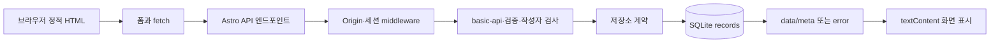

# studyMidpoint · Astro 학습 게시판

## ① 목표 한 줄

study0~10의 환경·템플릿·컴포넌트·폼·DB·인증·테스트·배포만으로 작은 게시판 서비스를 완성한다.

### 기능 목록

| 기능 | 화면·API | 배운 단계 |
|---|---|---|
| 정적 랜딩 | `/` | study1·2 |
| 콘텐츠 컬렉션·MDX 안내 | `/notes/welcome` | study4 |
| 검색·페이지·목록·상세 | `/board`, GET `/api/posts`, GET `/api/posts/{id}` | study4·6 |
| 회원가입·로그인·로그아웃·내 정보 | `/auth`, `/api/auth/*` | study5·7 |
| 작성·부분수정·삭제와 작성자 확인 | POST/PATCH/DELETE 게시글 API | study6·7 |
| 댓글 작성·조회·작성자 삭제 | 게시글 하위 댓글과 `/api/comments/{id}` | study6·7 |
| SQLite 파일 저장과 요청 테스트 | `data/desk.sqlite`, tests/scripts | study6·9 |
| Node 배포용 빌드 | `dist/client`, `dist/server` | study10 |

원문 기준은 [Notion Astro](https://app.notion.com/p/3fdd7dec5e2e8136a3d7e7023440d36f), API 기준은 [공통 API v1](https://app.notion.com/p/3d6d7dec5e2e8139adbfd36dd506c65e)다.

## ② 📖 이론

정적 페이지는 먼저 준비한 서비스 안내판이고, 로그인·쓰기·DB는 방문할 때 처리하는 접수 창구다. 정적 HTML에 개인 세션을 박지 않고 브라우저가 API에서 현재 데이터를 읽게 한다. 카드·레이아웃은 공통 부품, API는 같은 출처의 Astro 엔드포인트, SQLite는 재시작 뒤에도 남는 원본이다.

midpoint는 캐시·외부 서비스·worker·실시간·AI를 사용하지 않는다. 같은 앱을 `COURSE_STAGE=midpoint`로 실행하면 기본 API가 목록을 직접 조회하고 심화 API를 404로 막는다. 별도 서버 프레임워크 없이 화면과 API를 모두 Astro가 담당한다. 최종 코드가 누적된 저장소이므로 심화 모듈 파일은 있어도 이 모드에서 실행 경로를 사용하지 않는다.

## ③ 🛠️ 실기

### 폴더 구조

```text
course/
  astro.config.mjs
  .env.example
  src/layouts/Desk.astro
  src/components/NoteCard.astro
  src/components/Draft.astro
  src/pages/index.astro
  src/pages/auth.astro
  src/pages/board.astro
  src/pages/api/[...path].js
  src/lib/basic-api.mjs
  src/lib/auth.mjs
  src/lib/posts.mjs
  src/lib/store.mjs
  src/lib/validation.mjs
  src/middleware.js
  tests/domain.test.mjs
  scripts/smoke.mjs
```

### 단계별 구현 순서

1. study0처럼 의존성·Git·.env를 준비하고 개발 서버를 확인한다.
2. study1·2의 홈·Desk·NoteCard로 정적 랜딩을 조립한다.
3. study3·4처럼 localStorage 초안과 콘텐츠 동적 URL을 만든다.
4. study5에서 폼의 기본 유효성·서버 schema·상태 메시지·제출 잠금을 연결한다.
5. study6의 openStore SQLite 분기로 records 테이블을 만들고 게시글 CRUD를 연결한다.
6. study7의 가입·scrypt·세션·HttpOnly 쿠키·작성자 검사를 연결한다.
7. study8의 모듈 분리와 환경변수 기본값을 대조한다.
8. study9의 단위·HTTP·브라우저 검사를 실행한다. 아래 full code와 의존 파일은 각 진도 전체 코드와 동일하다.
9. study10의 build/start로 1차 운영 산출물을 확인한다.

```powershell
cd course
npm ci
Copy-Item .env.example .env
$env:COURSE_STAGE='midpoint'
npm run build
npm start
```

1행은 앱 이동, 2행은 고정 설치, 3행은 새 환경파일 생성(기존 파일이 있으면 편집), 4행은 기초 기능 모드, 5행은 정적/서버 빌드, 6행은 실행이다. 같은 셸의 COURSE_STAGE를 유지해야 API도 midpoint로 실행된다. 운영은 환경변수로 COURSE_STAGE=midpoint를 넣는다. `/auth`에서 가입하고 로그인한 다음 `/board`에서 등록·수정·댓글·삭제를 확인한다.

### 핵심 구현 전체 코드와 줄별 설명

### `course/src/lib/basic-api.mjs` 전체 코드

[basic-api.mjs](course/src/lib/basic-api.mjs)를 그대로 사용한다. 코드 블록의 줄 번호는 바로 아래 설명표와 일치한다.

```javascript
import { z } from 'zod';
import { body, fail, json, positiveId } from './http.mjs';
import { signupSchema, loginSchema, validate } from './validation.mjs';
import { signup, login, publicUser, requireUser, owned, digest } from './auth.mjs';
import { listPosts, serializePost, createPost, updatePost, deletePost } from './posts.mjs';
import { postCache } from './cache.mjs';
import { settings } from './config.mjs';

export function sessionCookie(context, token) {
  context.cookies.set('desk_session', token, { path: '/', httpOnly: true, sameSite: 'lax', secure: settings().site.startsWith('https:'), maxAge: 3600 });
}
export async function dispatchBasic(context, store) {
  const { request, url, locals } = context, method = request.method;
  const path = url.pathname.replace(/\/$/, ''), user = locals.user;
  if (path === '/api/auth/signup' && method === 'POST') {
    const created = await signup(store, validate(signupSchema, await body(request)));
    return json({ data: publicUser(created) }, 201);
  }
  if (path === '/api/auth/login' && method === 'POST') {
    const data = await login(store, validate(loginSchema, await body(request)));
    sessionCookie(context, data.accessToken); return json({ data });
  }
  if (path === '/api/auth/me' && method === 'GET') return json({ data: requireUser(user) });
  if (path === '/api/auth/logout' && method === 'POST') {
    requireUser(user);
    for (const session of await store.list('sessions')) if (session.digest === digest(locals.token)) await store.remove('sessions', session.id);
    context.cookies.delete('desk_session', { path: '/' }); return new Response(null, { status: 204 });
  }
  if (path === '/api/posts') {
    if (method === 'GET') return json(process.env.COURSE_STAGE === 'midpoint' ? await listPosts(store, url) : await postCache.get(url.search, () => listPosts(store, url)));
    if (method === 'POST') {
      const data = await createPost(store, user, await body(request)); postCache.clear();
      return json({ data }, 201, { Location: `/api/posts/${data.id}` });
    }
    fail(405, 'METHOD_NOT_ALLOWED', 'GET 또는 POST를 사용하세요.');
  }
  let match = path.match(/^\/api\/posts\/([^/]+)$/);
  if (match) {
    const id = positiveId(match[1]);
    if (method === 'GET') return json({ data: await serializePost(store, await store.get('posts', id)) });
    if (method === 'PATCH') { const data = await updatePost(store, user, id, await body(request)); postCache.clear(); return json({ data }); }
    if (method === 'DELETE') { await deletePost(store, user, id); postCache.clear(); return new Response(null, { status: 204 }); }
    fail(405, 'METHOD_NOT_ALLOWED', 'GET/PATCH/DELETE를 사용하세요.');
  }
  match = path.match(/^\/api\/posts\/([^/]+)\/comments$/);
  if (match) {
    const postId = positiveId(match[1]);
    if (!(await store.get('posts', postId))) fail(404, 'NOT_FOUND', '글이 없습니다.');
    if (method === 'GET') {
      const comments = (await store.list('comments')).filter(c => c.postId === postId);
      const data = await Promise.all(comments.map(async c => ({ id: c.id, body: c.body, postId, createdAt: c.createdAt,
        author: { id: c.authorId, nickname: (await store.get('users', c.authorId)).nickname } })));
      return json({ data });
    }
    if (method === 'POST') {
      requireUser(user);
      const input = validate(z.object({ body: z.string().trim().min(1).max(2000) }).strict(), await body(request));
      const c = await store.create('comments', { ...input, postId, authorId: user.id, createdAt: new Date().toISOString() });
      postCache.clear();
      return json({ data: { id: c.id, body: c.body, postId, author: { id: user.id, nickname: user.nickname }, createdAt: c.createdAt } }, 201);
    }
  }
  match = path.match(/^\/api\/comments\/([^/]+)$/);
  if (match && method === 'DELETE') {
    const id = positiveId(match[1]); owned(await store.get('comments', id), user);
    await store.remove('comments', id); postCache.clear(); return new Response(null, { status: 204 });
  }
  return null;
}
```

줄별 설명:

| 줄 | 설명 |
|---|---|
| 1 | `'zod'`의 기능을 이 파일에서 사용한다. |
| 2 | `'./http.mjs'`의 기능을 이 파일에서 사용한다. |
| 3 | `'./validation.mjs'`의 기능을 이 파일에서 사용한다. |
| 4 | `'./auth.mjs'`의 기능을 이 파일에서 사용한다. |
| 5 | `'./posts.mjs'`의 기능을 이 파일에서 사용한다. |
| 6 | `'./cache.mjs'`의 기능을 이 파일에서 사용한다. |
| 7 | `'./config.mjs'`의 기능을 이 파일에서 사용한다. |
| 8 | 코드 구간을 나누는 빈 줄이다. |
| 9 | 재사용 함수 `sessionCookie`를 정의한다. |
| 10 | 서버가 쿠키와 보안 속성을 응답에 설정한다. |
| 11 | 앞서 연 함수·객체·호출의 범위를 닫는다. |
| 12 | 비동기 함수 `dispatchBasic`의 입력과 처리 범위를 정의한다. |
| 13 | 이 이름의 값·객체·함수를 선언해 아래 처리에서 사용한다: `const { request, url, locals }`. |
| 14 | 이 이름의 값·객체·함수를 선언해 아래 처리에서 사용한다: `const path`. |
| 15 | 조건에 따라 성공·오류 또는 실행 환경별 경로를 선택한다. |
| 16 | 정해진 스키마로 입력을 검사하고 허용된 값만 다음 계층으로 보낸다. |
| 17 | 명시한 상태와 JSON 응답 본문을 HTTP 계약에 맞춰 반환한다. |
| 18 | 앞서 연 함수·객체·호출의 범위를 닫는다. |
| 19 | 조건에 따라 성공·오류 또는 실행 환경별 경로를 선택한다. |
| 20 | 정해진 스키마로 입력을 검사하고 허용된 값만 다음 계층으로 보낸다. |
| 21 | 명시한 상태와 JSON 응답 본문을 HTTP 계약에 맞춰 반환한다. |
| 22 | 앞서 연 함수·객체·호출의 범위를 닫는다. |
| 23 | 미인증 사용자를 401로 거절하고 인증 사용자만 다음 처리를 허용한다. |
| 24 | 조건에 따라 성공·오류 또는 실행 환경별 경로를 선택한다. |
| 25 | 미인증 사용자를 401로 거절하고 인증 사용자만 다음 처리를 허용한다. |
| 26 | 지정 kind와 id의 레코드를 삭제한다. |
| 27 | 같은 경로의 쿠키를 만료시켜 브라우저 출입증을 지운다. |
| 28 | 앞서 연 함수·객체·호출의 범위를 닫는다. |
| 29 | 조건에 따라 성공·오류 또는 실행 환경별 경로를 선택한다. |
| 30 | 실행/빌드 환경에서 설정을 읽어 기본값 또는 분기를 결정한다. |
| 31 | 조건에 따라 성공·오류 또는 실행 환경별 경로를 선택한다. |
| 32 | 이 이름의 값·객체·함수를 선언해 아래 처리에서 사용한다: `const data`. |
| 33 | 명시한 상태와 JSON 응답 본문을 HTTP 계약에 맞춰 반환한다. |
| 34 | 앞서 연 함수·객체·호출의 범위를 닫는다. |
| 35 | 조건에 맞지 않는 요청은 명시한 상태 코드와 공통 오류로 중단한다. |
| 36 | 앞서 연 함수·객체·호출의 범위를 닫는다. |
| 37 | 이 이름의 값·객체·함수를 선언해 아래 처리에서 사용한다: `let match`. |
| 38 | 조건에 따라 성공·오류 또는 실행 환경별 경로를 선택한다. |
| 39 | 이 이름의 값·객체·함수를 선언해 아래 처리에서 사용한다: `const id`. |
| 40 | 명시한 상태와 JSON 응답 본문을 HTTP 계약에 맞춰 반환한다. |
| 41 | 명시한 상태와 JSON 응답 본문을 HTTP 계약에 맞춰 반환한다. |
| 42 | 응답 본문·상태·헤더 또는 스트림을 담은 HTTP Response를 만든다. |
| 43 | 조건에 맞지 않는 요청은 명시한 상태 코드와 공통 오류로 중단한다. |
| 44 | 앞서 연 함수·객체·호출의 범위를 닫는다. |
| 45 | 현재 처리 구간의 세부 값·호출·구조를 지정한다: `match = path.match(/^\/api\/posts\/([^/]+)\/comments$/);`. |
| 46 | 조건에 따라 성공·오류 또는 실행 환경별 경로를 선택한다. |
| 47 | 이 이름의 값·객체·함수를 선언해 아래 처리에서 사용한다: `const postId`. |
| 48 | 조건에 맞지 않는 요청은 명시한 상태 코드와 공통 오류로 중단한다. |
| 49 | 조건에 따라 성공·오류 또는 실행 환경별 경로를 선택한다. |
| 50 | 저장소에서 해당 종류의 레코드를 읽어 필터·검증·응답에 사용한다. |
| 51 | 목록의 각 항목을 화면 또는 응답에 필요한 모양으로 변환한다. |
| 52 | 종류와 id가 일치하는 단일 레코드를 조회한다. |
| 53 | 명시한 상태와 JSON 응답 본문을 HTTP 계약에 맞춰 반환한다. |
| 54 | 앞서 연 함수·객체·호출의 범위를 닫는다. |
| 55 | 조건에 따라 성공·오류 또는 실행 환경별 경로를 선택한다. |
| 56 | 미인증 사용자를 401로 거절하고 인증 사용자만 다음 처리를 허용한다. |
| 57 | 정해진 스키마로 입력을 검사하고 허용된 값만 다음 계층으로 보낸다. |
| 58 | 저장소 계약으로 새 레코드를 생성하며 생성 id를 받는다. |
| 59 | 현재 처리 구간의 세부 값·호출·구조를 지정한다: `postCache.clear();`. |
| 60 | 명시한 상태와 JSON 응답 본문을 HTTP 계약에 맞춰 반환한다. |
| 61 | 앞서 연 함수·객체·호출의 범위를 닫는다. |
| 62 | 앞서 연 함수·객체·호출의 범위를 닫는다. |
| 63 | 현재 처리 구간의 세부 값·호출·구조를 지정한다: `match = path.match(/^\/api\/comments\/([^/]+)$/);`. |
| 64 | 조건에 따라 성공·오류 또는 실행 환경별 경로를 선택한다. |
| 65 | 자원 존재와 작성자 일치를 확인해 다른 사람의 데이터 접근을 막는다. |
| 66 | 응답 본문·상태·헤더 또는 스트림을 담은 HTTP Response를 만든다. |
| 67 | 앞서 연 함수·객체·호출의 범위를 닫는다. |
| 68 | 이 함수의 처리 결과를 호출자에게 반환하고 실행을 끝낸다. |
| 69 | 앞서 연 함수·객체·호출의 범위를 닫는다. |

### `course/src/lib/posts.mjs` 전체 코드

[posts.mjs](course/src/lib/posts.mjs)를 그대로 사용한다. 코드 블록의 줄 번호는 바로 아래 설명표와 일치한다.

```javascript
import { fail } from './http.mjs';
import { owned, requireUser } from './auth.mjs';
import { postSchema, validate, listQuery } from './validation.mjs';

export async function serializePost(store, post) {
  if (!post) fail(404, 'NOT_FOUND', '글이 없습니다.');
  const author = await store.get('users', post.authorId);
  const comments = (await store.list('comments')).filter(c => c.postId === post.id);
  return { id: post.id, title: post.title, body: post.body, tags: post.tags,
    author: { id: author.id, nickname: author.nickname }, commentCount: comments.length,
    createdAt: post.createdAt, updatedAt: post.updatedAt };
}
export async function listPosts(store, url) {
  const { page, limit, q, sort } = listQuery(url), needle = q.toLowerCase();
  const posts = (await store.list('posts')).filter(p => `${p.title} ${p.body}`.toLowerCase().includes(needle));
  const data = await Promise.all(posts.map(post => serializePost(store, post)));
  data.sort((a, b) => sort === '-commentCount' ? b.commentCount - a.commentCount || b.id - a.id : (sort === 'createdAt' ? 1 : -1) * (a.createdAt.localeCompare(b.createdAt) || a.id - b.id));
  return { data: data.slice((page - 1) * limit, page * limit), meta: { page, limit, total: data.length, totalPages: Math.ceil(data.length / limit), q } };
}
export async function createPost(store, user, input) {
  requireUser(user);
  const values = validate(postSchema, input), now = new Date().toISOString();
  return serializePost(store, await store.create('posts', { ...values, authorId: user.id, createdAt: now, updatedAt: now }));
}
export async function updatePost(store, user, id, input) {
  const old = owned(await store.get('posts', id), user);
  const patch = validate(postSchema.partial().extend({ tags: postSchema.shape.tags.unwrap().optional() }), input);
  if (!Object.keys(patch).length) fail(400, 'VALIDATION_ERROR', '수정할 필드가 필요합니다.');
  const next = { ...old, ...patch, updatedAt: new Date().toISOString() };
  await store.replace('posts', id, next); return serializePost(store, next);
}
export async function deletePost(store, user, id) {
  owned(await store.get('posts', id), user);
  // 학습용 단일 인스턴스. 운영에서는 FK cascade/트랜잭션으로 이 경계를 묶는다.
  for (const c of await store.list('comments')) if (c.postId === id) await store.remove('comments', c.id);
  await store.remove('posts', id);
}
```

줄별 설명:

| 줄 | 설명 |
|---|---|
| 1 | `'./http.mjs'`의 기능을 이 파일에서 사용한다. |
| 2 | `'./auth.mjs'`의 기능을 이 파일에서 사용한다. |
| 3 | `'./validation.mjs'`의 기능을 이 파일에서 사용한다. |
| 4 | 코드 구간을 나누는 빈 줄이다. |
| 5 | 비동기 함수 `serializePost`의 입력과 처리 범위를 정의한다. |
| 6 | 조건에 맞지 않는 요청은 명시한 상태 코드와 공통 오류로 중단한다. |
| 7 | 종류와 id가 일치하는 단일 레코드를 조회한다. |
| 8 | 저장소에서 해당 종류의 레코드를 읽어 필터·검증·응답에 사용한다. |
| 9 | 이 함수의 처리 결과를 호출자에게 반환하고 실행을 끝낸다. |
| 10 | 현재 처리 구간의 세부 값·호출·구조를 지정한다: `author: { id: author.id, nickname: author.nickname }, commentCount: comments.length,`. |
| 11 | 현재 처리 구간의 세부 값·호출·구조를 지정한다: `createdAt: post.createdAt, updatedAt: post.updatedAt };`. |
| 12 | 앞서 연 함수·객체·호출의 범위를 닫는다. |
| 13 | 비동기 함수 `listPosts`의 입력과 처리 범위를 정의한다. |
| 14 | 이 이름의 값·객체·함수를 선언해 아래 처리에서 사용한다: `const { page, limit, q, sort }`. |
| 15 | 저장소에서 해당 종류의 레코드를 읽어 필터·검증·응답에 사용한다. |
| 16 | 목록의 각 항목을 화면 또는 응답에 필요한 모양으로 변환한다. |
| 17 | 정해진 비교 규칙에 따라 결과 순서를 맞춘다. |
| 18 | 이 함수의 처리 결과를 호출자에게 반환하고 실행을 끝낸다. |
| 19 | 앞서 연 함수·객체·호출의 범위를 닫는다. |
| 20 | 비동기 함수 `createPost`의 입력과 처리 범위를 정의한다. |
| 21 | 미인증 사용자를 401로 거절하고 인증 사용자만 다음 처리를 허용한다. |
| 22 | 정해진 스키마로 입력을 검사하고 허용된 값만 다음 계층으로 보낸다. |
| 23 | 저장소 계약으로 새 레코드를 생성하며 생성 id를 받는다. |
| 24 | 앞서 연 함수·객체·호출의 범위를 닫는다. |
| 25 | 비동기 함수 `updatePost`의 입력과 처리 범위를 정의한다. |
| 26 | 자원 존재와 작성자 일치를 확인해 다른 사람의 데이터 접근을 막는다. |
| 27 | 정해진 스키마로 입력을 검사하고 허용된 값만 다음 계층으로 보낸다. |
| 28 | 조건에 맞지 않는 요청은 명시한 상태 코드와 공통 오류로 중단한다. |
| 29 | 이 이름의 값·객체·함수를 선언해 아래 처리에서 사용한다: `const next`. |
| 30 | 검증한 변경 값을 지정 레코드에 저장한다. |
| 31 | 앞서 연 함수·객체·호출의 범위를 닫는다. |
| 32 | 비동기 함수 `deletePost`의 입력과 처리 범위를 정의한다. |
| 33 | 자원 존재와 작성자 일치를 확인해 다른 사람의 데이터 접근을 막는다. |
| 34 | 학습용 단일 인스턴스. 운영에서는 FK cascade/트랜잭션으로 이 경계를 묶는다. |
| 35 | 지정 kind와 id의 레코드를 삭제한다. |
| 36 | 지정 kind와 id의 레코드를 삭제한다. |
| 37 | 앞서 연 함수·객체·호출의 범위를 닫는다. |

### `course/src/pages/board.astro` 전체 코드

[board.astro](course/src/pages/board.astro)를 그대로 사용한다. 코드 블록의 줄 번호는 바로 아래 설명표와 일치한다.

```astro
---
import Desk from '../layouts/Desk.astro';
---
<Desk title="게시판">
  <h1>학습 게시판</h1>
  <form id="search"><label>검색 <input name="q" type="search" /></label><button>찾기</button></form>
  <p id="message" role="status" aria-live="polite"></p>
  <section id="posts" aria-label="글 목록"></section>
  <div class="actions"><button id="prev" type="button">이전</button><span id="page"></span><button id="next" type="button">다음</button></div>
  <h2>글 작성·수정</h2><p>글과 댓글 작성에는 <a href="/auth">로그인</a>이 필요합니다.</p>
  <form id="editor">
    <label>수정할 글 ID (비우면 등록)<input name="id" inputmode="numeric" /></label>
    <label>제목<input name="title" required maxlength="200" /></label>
    <label>본문<textarea name="body" required maxlength="20000"></textarea></label>
    <label>태그 (쉼표 구분)<input name="tags" /></label><button>저장</button>
  </form>
  <h2>댓글</h2>
  <form id="comment-form"><label>글 ID<input name="postId" required inputmode="numeric" /></label>
    <label>댓글<textarea name="body" maxlength="2000" required></textarea></label>
    <button>댓글 작성</button><button id="load-comments" type="button">댓글 조회</button>
  </form><section id="comments" aria-label="댓글 목록"></section>
</Desk>
<script>
  import { api, formAction, show } from '../client/api.mjs';
  const params = new URLSearchParams(location.search);
  let page = Number(params.get('page')) || 1, totalPages = 0;
  const search = document.querySelector<HTMLFormElement>('#search')!;
  (search.elements.namedItem('q') as HTMLInputElement).value = params.get('q') || '';
  async function load() {
    params.set('page', String(page)); params.set('limit', '5'); history.replaceState(null, '', `?${params}`);
    const result = await api(`/api/posts?${params}`); totalPages = result.meta.totalPages;
    const target = document.querySelector('#posts')!; target.replaceChildren();
    for (const post of result.data) {
      const article = document.createElement('article'), title = document.createElement('h2'), text = document.createElement('pre'), meta = document.createElement('p');
      title.textContent = `${post.id}. ${post.title}`; text.textContent = post.body; meta.textContent = `${post.author.nickname} · 댓글 ${post.commentCount}`;
      const edit = document.createElement('button'); edit.type = 'button'; edit.textContent = '편집';
      edit.onclick = () => { const f = document.querySelector<HTMLFormElement>('#editor')!; for (const key of ['id', 'title', 'body', 'tags']) (f.elements.namedItem(key) as HTMLInputElement).value = key === 'tags' ? post.tags.join(',') : String(post[key]); };
      const remove = document.createElement('button'); remove.type = 'button'; remove.textContent = '삭제';
      remove.onclick = async () => { if (!confirm('이 글을 삭제할까요?')) return; try { await api(`/api/posts/${post.id}`, { method: 'DELETE' }); await load(); } catch (e) { show(e); } };
      article.append(title, text, meta, edit, remove); target.append(article);
    }
    document.querySelector('#page')!.textContent = `${page} / ${Math.max(1, totalPages)}`;
    (document.querySelector('#prev') as HTMLButtonElement).disabled = page <= 1;
    (document.querySelector('#next') as HTMLButtonElement).disabled = page >= totalPages;
  }
  search.onsubmit = e => { e.preventDefault(); params.set('q', String(new FormData(search).get('q') || '')); page = 1; load().catch(show); };
  document.querySelector('#prev')!.addEventListener('click', () => { page = Math.max(1, page - 1); load().catch(show); });
  document.querySelector('#next')!.addEventListener('click', () => { page++; load().catch(show); });
  formAction('#editor', async values => {
    const id = values.id.trim(), payload = { title: values.title, body: values.body, tags: values.tags.split(',').map(t => t.trim()).filter(Boolean) };
    const { data } = await api(id ? `/api/posts/${id}` : '/api/posts', { method: id ? 'PATCH' : 'POST', body: JSON.stringify(payload) });
    show(`저장 완료: ${data.id}`); await load();
  });
  async function comments() {
    const f = document.querySelector<HTMLFormElement>('#comment-form')!, id = new FormData(f).get('postId');
    const { data } = await api(`/api/posts/${id}/comments`), target = document.querySelector('#comments')!; target.replaceChildren();
    for (const c of data) { const p = document.createElement('p'), b = document.createElement('button'); p.textContent = `${c.author.nickname}: ${c.body} `; b.textContent = '댓글 삭제'; b.type = 'button';
      b.onclick = async () => { try { await api(`/api/comments/${c.id}`, { method: 'DELETE' }); await comments(); await load(); } catch (e) { show(e); } }; p.append(b); target.append(p); }
  }
  formAction('#comment-form', async values => { await api(`/api/posts/${values.postId}/comments`, { method: 'POST', body: JSON.stringify({ body: values.body }) }); await comments(); await load(); show('댓글을 저장했습니다.'); });
  document.querySelector('#load-comments')!.addEventListener('click', () => comments().catch(show));
  load().catch(show);
</script>
```

줄별 설명:

| 줄 | 설명 |
|---|---|
| 1 | 서버 frontmatter와 HTML 템플릿의 경계를 표시한다. |
| 2 | `'../layouts/Desk.astro'`의 기능을 이 파일에서 사용한다. |
| 3 | 서버 frontmatter와 HTML 템플릿의 경계를 표시한다. |
| 4 | 이 HTML·컴포넌트·템플릿 표현식을 현재 위치에 출력한다. |
| 5 | 이 HTML·컴포넌트·템플릿 표현식을 현재 위치에 출력한다. |
| 6 | 이 HTML·컴포넌트·템플릿 표현식을 현재 위치에 출력한다. |
| 7 | 이 HTML·컴포넌트·템플릿 표현식을 현재 위치에 출력한다. |
| 8 | 이 HTML·컴포넌트·템플릿 표현식을 현재 위치에 출력한다. |
| 9 | 이 HTML·컴포넌트·템플릿 표현식을 현재 위치에 출력한다. |
| 10 | 이 HTML·컴포넌트·템플릿 표현식을 현재 위치에 출력한다. |
| 11 | 이 HTML·컴포넌트·템플릿 표현식을 현재 위치에 출력한다. |
| 12 | 이 HTML·컴포넌트·템플릿 표현식을 현재 위치에 출력한다. |
| 13 | 이 HTML·컴포넌트·템플릿 표현식을 현재 위치에 출력한다. |
| 14 | 이 HTML·컴포넌트·템플릿 표현식을 현재 위치에 출력한다. |
| 15 | 이 HTML·컴포넌트·템플릿 표현식을 현재 위치에 출력한다. |
| 16 | 이 HTML·컴포넌트·템플릿 표현식을 현재 위치에 출력한다. |
| 17 | 이 HTML·컴포넌트·템플릿 표현식을 현재 위치에 출력한다. |
| 18 | 이 HTML·컴포넌트·템플릿 표현식을 현재 위치에 출력한다. |
| 19 | 이 HTML·컴포넌트·템플릿 표현식을 현재 위치에 출력한다. |
| 20 | 이 HTML·컴포넌트·템플릿 표현식을 현재 위치에 출력한다. |
| 21 | 이 HTML·컴포넌트·템플릿 표현식을 현재 위치에 출력한다. |
| 22 | 이 HTML·컴포넌트·템플릿 표현식을 현재 위치에 출력한다. |
| 23 | 브라우저에서 실행할 이벤트·DOM 코드의 경계를 정한다. |
| 24 | `'../client/api.mjs'`의 기능을 이 파일에서 사용한다. |
| 25 | 이 이름의 값·객체·함수를 선언해 아래 처리에서 사용한다: `const params`. |
| 26 | 이 이름의 값·객체·함수를 선언해 아래 처리에서 사용한다: `let page`. |
| 27 | 이 이름의 값·객체·함수를 선언해 아래 처리에서 사용한다: `const search`. |
| 28 | 현재 처리 구간의 세부 값·호출·구조를 지정한다: `(search.elements.namedItem('q') as HTMLInputElement).value = params.get('q') &#124;&#124; '';`. |
| 29 | 비동기 함수 `load`의 입력과 처리 범위를 정의한다. |
| 30 | 현재 처리 구간의 세부 값·호출·구조를 지정한다: `params.set('page', String(page)); params.set('limit', '5'); history.replaceState(null, '', ?${params});`. |
| 31 | 이 이름의 값·객체·함수를 선언해 아래 처리에서 사용한다: `const result`. |
| 32 | 이 이름의 값·객체·함수를 선언해 아래 처리에서 사용한다: `const target`. |
| 33 | 목록 또는 스트림의 남은 항목을 순서대로 처리한다. |
| 34 | 이 이름의 값·객체·함수를 선언해 아래 처리에서 사용한다: `const article`. |
| 35 | 문자열을 HTML로 실행하지 않고 텍스트로 표시해 XSS 표면을 줄인다. |
| 36 | 문자열을 HTML로 실행하지 않고 텍스트로 표시해 XSS 표면을 줄인다. |
| 37 | 브라우저 이벤트가 발생했을 때 실행할 함수를 연결한다. |
| 38 | 문자열을 HTML로 실행하지 않고 텍스트로 표시해 XSS 표면을 줄인다. |
| 39 | 실패 경로를 받아 사용자 오류 또는 내부 오류로 처리한다. |
| 40 | 현재 처리 구간의 세부 값·호출·구조를 지정한다: `article.append(title, text, meta, edit, remove); target.append(article);`. |
| 41 | 앞서 연 함수·객체·호출의 범위를 닫는다. |
| 42 | 문자열을 HTML로 실행하지 않고 텍스트로 표시해 XSS 표면을 줄인다. |
| 43 | 현재 처리 구간의 세부 값·호출·구조를 지정한다: `(document.querySelector('#prev') as HTMLButtonElement).disabled = page <= 1;`. |
| 44 | 현재 처리 구간의 세부 값·호출·구조를 지정한다: `(document.querySelector('#next') as HTMLButtonElement).disabled = page >= totalPages;`. |
| 45 | 앞서 연 함수·객체·호출의 범위를 닫는다. |
| 46 | 실패 경로를 받아 사용자 오류 또는 내부 오류로 처리한다. |
| 47 | 실패 경로를 받아 사용자 오류 또는 내부 오류로 처리한다. |
| 48 | 실패 경로를 받아 사용자 오류 또는 내부 오류로 처리한다. |
| 49 | 현재 처리 구간의 세부 값·호출·구조를 지정한다: `formAction('#editor', async values => {`. |
| 50 | 목록의 각 항목을 화면 또는 응답에 필요한 모양으로 변환한다. |
| 51 | 객체를 JSON 문자열로 직렬화해 HTTP 또는 저장소에 전달한다. |
| 52 | 현재 처리 구간의 세부 값·호출·구조를 지정한다: `show(저장 완료: ${data.id}); await load();`. |
| 53 | 앞서 연 함수·객체·호출의 범위를 닫는다. |
| 54 | 비동기 함수 `comments`의 입력과 처리 범위를 정의한다. |
| 55 | 이 이름의 값·객체·함수를 선언해 아래 처리에서 사용한다: `const f`. |
| 56 | 이 이름의 값·객체·함수를 선언해 아래 처리에서 사용한다: `const { data }`. |
| 57 | 문자열을 HTML로 실행하지 않고 텍스트로 표시해 XSS 표면을 줄인다. |
| 58 | 실패 경로를 받아 사용자 오류 또는 내부 오류로 처리한다. |
| 59 | 앞서 연 함수·객체·호출의 범위를 닫는다. |
| 60 | 객체를 JSON 문자열로 직렬화해 HTTP 또는 저장소에 전달한다. |
| 61 | 실패 경로를 받아 사용자 오류 또는 내부 오류로 처리한다. |
| 62 | 실패 경로를 받아 사용자 오류 또는 내부 오류로 처리한다. |
| 63 | 브라우저에서 실행할 이벤트·DOM 코드의 경계를 정한다. |

### `course/src/pages/auth.astro` 전체 코드

[auth.astro](course/src/pages/auth.astro)를 그대로 사용한다. 코드 블록의 줄 번호는 바로 아래 설명표와 일치한다.

```astro
---
import Desk from '../layouts/Desk.astro';
---
<Desk title="계정">
  <h1>계정</h1><p id="message" role="status" aria-live="polite"></p>
  <form id="signup"><h2>회원가입</h2>
    <label>이메일<input name="email" type="email" required autocomplete="email" /></label>
    <label>비밀번호<input name="password" type="password" minlength="10" maxlength="128" required autocomplete="new-password" /></label>
    <label>별명<input name="nickname" maxlength="40" required /></label><button>가입</button>
  </form>
  <form id="login"><h2>로그인</h2>
    <label>이메일<input name="email" type="email" required autocomplete="username" /></label>
    <label>비밀번호<input name="password" type="password" minlength="10" maxlength="128" required autocomplete="current-password" /></label><button>로그인</button>
  </form>
  <div class="actions"><button id="me" type="button">내 정보</button><button id="logout" type="button">로그아웃</button><a href="/api/oauth/start">GitHub 로그인 (설정 후)</a></div>
</Desk>
<script>
  import { api, formAction, show } from '../client/api.mjs';
  formAction('#signup', async values => { await api('/api/auth/signup', { method: 'POST', body: JSON.stringify(values) }); show('가입했습니다. 로그인하세요.'); });
  formAction('#login', async values => { const { data } = await api('/api/auth/login', { method: 'POST', body: JSON.stringify(values) }); show(`${data.user.nickname}님 로그인했습니다.`); });
  document.querySelector('#me')!.addEventListener('click', async () => { try { show(JSON.stringify((await api('/api/auth/me')).data)); } catch (e) { show(e); } });
  document.querySelector('#logout')!.addEventListener('click', async () => { try { await api('/api/auth/logout', { method: 'POST', body: '{}' }); show('로그아웃했습니다.'); } catch (e) { show(e); } });
</script>
```

줄별 설명:

| 줄 | 설명 |
|---|---|
| 1 | 서버 frontmatter와 HTML 템플릿의 경계를 표시한다. |
| 2 | `'../layouts/Desk.astro'`의 기능을 이 파일에서 사용한다. |
| 3 | 서버 frontmatter와 HTML 템플릿의 경계를 표시한다. |
| 4 | 이 HTML·컴포넌트·템플릿 표현식을 현재 위치에 출력한다. |
| 5 | 이 HTML·컴포넌트·템플릿 표현식을 현재 위치에 출력한다. |
| 6 | 이 HTML·컴포넌트·템플릿 표현식을 현재 위치에 출력한다. |
| 7 | 이 HTML·컴포넌트·템플릿 표현식을 현재 위치에 출력한다. |
| 8 | 이 HTML·컴포넌트·템플릿 표현식을 현재 위치에 출력한다. |
| 9 | 이 HTML·컴포넌트·템플릿 표현식을 현재 위치에 출력한다. |
| 10 | 이 HTML·컴포넌트·템플릿 표현식을 현재 위치에 출력한다. |
| 11 | 이 HTML·컴포넌트·템플릿 표현식을 현재 위치에 출력한다. |
| 12 | 이 HTML·컴포넌트·템플릿 표현식을 현재 위치에 출력한다. |
| 13 | 이 HTML·컴포넌트·템플릿 표현식을 현재 위치에 출력한다. |
| 14 | 이 HTML·컴포넌트·템플릿 표현식을 현재 위치에 출력한다. |
| 15 | 이 HTML·컴포넌트·템플릿 표현식을 현재 위치에 출력한다. |
| 16 | 이 HTML·컴포넌트·템플릿 표현식을 현재 위치에 출력한다. |
| 17 | 브라우저에서 실행할 이벤트·DOM 코드의 경계를 정한다. |
| 18 | `'../client/api.mjs'`의 기능을 이 파일에서 사용한다. |
| 19 | 객체를 JSON 문자열로 직렬화해 HTTP 또는 저장소에 전달한다. |
| 20 | 객체를 JSON 문자열로 직렬화해 HTTP 또는 저장소에 전달한다. |
| 21 | 실패 경로를 받아 사용자 오류 또는 내부 오류로 처리한다. |
| 22 | 실패 경로를 받아 사용자 오류 또는 내부 오류로 처리한다. |
| 23 | 브라우저에서 실행할 이벤트·DOM 코드의 경계를 정한다. |

## ④ 🔗 연동 포인트

### DB·API 연동 구성도



DB 모델은 users(email·nickname·passwordHash), sessions(userId·digest·expiresAt), posts(title·body·tags·authorId·시각), comments(postId·body·authorId·createdAt)다. records의 kind로 모델을 구분한다. 연결 경로와 종류는 환경변수이며 SQL은 바인딩한다. DB를 바꾸는 일은 study11부터다.

목록 응답은 data와 meta, 단건은 data, 오류는 error다. 세션은 쿠키와 Bearer가 같은 digest 저장소를 사용한다. 삭제·로그아웃의 204는 클라이언트에서 JSON으로 읽지 않는다. 다음 단계에서 이 계약을 유지하며 DB를 확장한다.

## ⑤ 오류 노트

| 증상 | 원인 | 해결 |
|---|---|---|
| 글 작성 401 | 미로그인·쿠키 host 차이 | 같은 host에서 로그인 후 요청 |
| 남의 글 수정 403 | 작성자 권한 검사 | 정상 동작이며 내 계정 글로 시험 |
| 등록 후 목록에 없음 | 필터·페이지 또는 캐시 설정 혼동 | 검색 초기화·page=1·midpoint 모드 확인 |
| 심화 API 404 | COURSE_STAGE=midpoint | 기초 과정의 의도된 동작 |
| 재시작 후 글 없음 | 다른 DB 경로·작업 폴더 | DATABASE_URL과 현재 디렉터리 확인 |

## ⑥ 직접 해보기

1. 서로 다른 두 계정으로 등록·조회·수정·삭제 권한 시나리오를 기록한다.
2. 검색 결과가 없는 페이지·마지막 페이지·존재하지 않는 id의 응답을 확인한다.
3. 서버를 재시작한 뒤 글과 댓글이 유지되는지 확인하고 DB 사본을 만들어 본다.

## ⑦ ☐ 체크리스트

### 1차 배포 체크리스트

- [ ] 정적 랜딩·콘텐츠·게시판·로그인 화면이 열린다.
- [ ] 가입 201·로그인 200·목록/상세 200·등록 201/Location·수정 200·삭제 204를 확인했다.
- [ ] 400·401·403·404·409 오류와 requestId를 확인했다.
- [ ] 비밀번호 해시가 응답에 없고 쿠키는 HttpOnly·SameSite이며 HTTPS에서 Secure다.
- [ ] .env·DB 파일이 Git에 없고 DB 경로는 영속 디스크다.
- [ ] npm test·build·test:http·브라우저 검사를 통과했다.
- [ ] HTTPS 공개 주소·환경변수·DB 경로·헬스체크를 배포 환경에서 확인한다.

### 회고

확인한 점: 정적 HTML과 동적 API를 같은 Astro 앱에 놓고도 DB·인증 경계를 명확하게 나눌 수 있다. 공통 API를 먼저 정하면 폼과 서버가 같은 필드와 상태 코드를 사용한다. 어려웠던 점은 PATCH의 기본값으로 태그가 비는 오류였고, 회귀 테스트로 기존 태그 보존을 확인했다.

남은 제약: JSON payload 저장소는 큰 목록에서 전체 스캔과 N+1 조회가 발생한다. 댓글 삭제와 글 삭제는 단일 트랜잭션이 아니어서 고부하 운영 전에 FK·트랜잭션으로 개선해야 한다. 외부 호스팅 배포는 실제 공개 주소에서 추가 확인한다.

## ⑧ 다음 단계 연결 문장

[study11.md](study11.md)에서 같은 서비스의 API 계약을 유지하며 DB 드라이버·인덱스·ORM 설정을 바꾼다. 최종 모드로 돌아가려면 셸의 COURSE_STAGE를 지우고 다시 빌드·실행한다.
